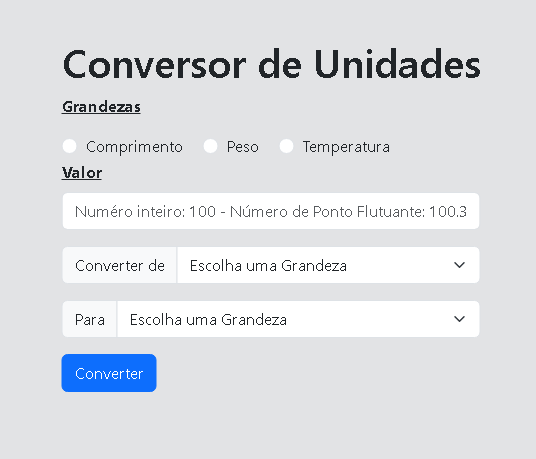

# Conversor de Unidades




> Aplicação web desenvolvida em PHP e jQuery para conversão dinâmica de unidades de medida (Comprimento, Peso e Temperatura), com carregamento assíncrono das opções via AJAX e interface estilizada com Bootstrap.

## 💻 Pré-requisitos

Antes de começar, verifique se você atendeu aos seguintes requisitos:

- Você instalou o **PHP 8.0** (ou versão mais recente).
- Você tem um navegador web moderno instalado (Chrome, Firefox, Edge ou Safari).
- Compatível com **Windows, Linux e macOS**.

## 🚀 Instalando o Conversor de Unidades

Para rodar o projeto localmente, siga estas etapas:

Linux, macOS e Windows:

```bash
# Clone este repositório
git clone [https://github.com/Alef-Developer/conversor-de-unidades.git](https://github.com/Alef-Developer/conversor-de-unidades.git)

# Acesse o diretório do projeto
cd conversor-de-unidades

```

## ☕ Usando o Conversor de Unidades

Para executar a aplicação na sua máquina, siga estas etapas:

1. Inicie o servidor embutido do PHP no diretório raiz do projeto:

```bash
php -S localhost:8000

```

2. Abra o seu navegador e acesse o endereço:

```
http://localhost:8000

```

3. Na interface:
* Selecione a grandeza desejada (**Comprimento**, **Peso** ou **Temperatura**).
* Insira o valor numérico que deseja converter.
* Escolha as unidades de origem (**Converter de**) e destino (**Para**).
* Clique no botão **Converter** para obter o resultado.


## 📫 Contribuindo para o Conversor de Unidades

Para contribuir com o Conversor de Unidades, siga estas etapas:

1. Bifurque este repositório.
2. Crie um branch: `git checkout -b feature/nova-funcionalidade`.
3. Faça suas alterações e confirme-as: `git commit -m 'feat: adiciona suporte a nova unidade'`
4. Envie para o branch original: `git push origin conversor-de-unidades / main`
5. Crie a solicitação de pull.

Como alternativa, consulte a documentação do GitHub em [como criar uma solicitação pull](https://help.github.com/en/github/collaborating-with-issues-and-pull-requests/creating-a-pull-request).

## 📝 Licença

Este projeto é de uso livre e acadêmico. Fique à vontade para estudar, clonar e modificar conforme suas necessidades!